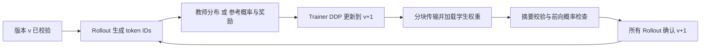

# Ray 多角色同步训练 demo

[返回主 README / 文档导航](README.md#navigation) · [单卡基础路线](README.md#single-gpu) · [训练讲解提纲](训练讲解提纲.md) · [面试自测](第二阶段Qwen面试问题清单.md)

**本文介绍 Ray 的运行与同步细节。** 单卡先完成主 README 的推理和 HF 训练，再按资源条件选择单卡 Ray 扩展。八卡命令位于独立的多卡分支。

本文直达：[单卡 Ray 能做什么与命令](#single-gpu) · [多卡能增加什么](#multi-gpu) · [角色布局](#roles) · [算法步骤](#algorithm) · [权重同步](#weight-sync) · [环境](#environment) · [八卡训练命令](#multi-training) · [八卡对比](#multi-benchmark) · [保存/回载](#checkpoints) · [验收](#validation)

本入口实际启动常驻的生成、教师／参考、训练及奖励 Actor，执行 OPSD 或 GRPO。它不再通过单个 Actor 启动 `train.py`。代码只在 `Qwen/demo/`，复用原项目视频模板、数据规则、奖励函数，以及固定版本 ms-swift 的模型接口和损失函数。

输入权重与主 README 一致：OPSD 继续训练 SFT LoRA，教师使用原 merge 产物；GRPO 继续训练 OPSD LoRA。Ray 重新组织了训练循环，并非直接调用正式训练脚本；数值一致性尚待 GPU 实测。

**当前验证状态：8 项 CPU 数学与 Ray 传输测试、OPSD/GRPO 单卡参数预检已在服务器通过；Ray 模型训练、DDP 和多卡加速尚未实测。** 参数预检使用 `--plan-only`，不加载 GPU 模型。本例三个 4B 模型副本的权重就超过 24 GB，当前 RTX 4090 D 使用主 README 的基础训练路线。所有命令从 `Msloc_code/` 执行，输出放在 `../MSLoc_data/Qwen/demo/`。

<a id="single-gpu"></a>
## 单卡分支：可选的 Ray 流程验证

| 单卡可以验证 | 单卡不能验证 |
|---|---|
| Trainer、Rollout、Scorer 是不同进程，GRPO 另有 CPU Reward | 角色分布到不同 GPU 的并行收益 |
| OPSD 的教师信号、GRPO 的奖励/优势、真实反传更新 | 多 Trainer 的 NCCL DDP 梯度同步：单卡只有一个 Trainer，不创建 DDP |
| 参数分块传输、摘要与前向校验、版本屏障 | 多生成副本、多教师副本的并行扩展效果 |
| checkpoint 保存、恢复和回载 | 八卡吞吐或单卡到八卡的加速比 |

**前提是三个 GPU 模型进程同时装得下。** Trainer、Rollout、Scorer 共用 GPU 0，显存不会因 Ray 分配 0.34/0.33/0.33 GPU 资源而被隔离或压缩。OPSD 需要 6 个逻辑 CPU、GRPO 需要 8 个（每角色 2 个）；对象存储仍要求 `/dev/shm` 至少有 8 GiB 可用空间。单卡能否运行取决于可用显存与具体配置。

先按[主 README](README.md#setup)准备环境、正式实验权重与数据；完整安装命令已包含 Ray，OPSD 还需[merge 与教师准入](README.md#preflight)。以下命令以 HF 生成后端验证同步流程，不要求 vLLM alignment。全局 batch=8、32 步等方法参数与八卡示例一致。

```bash
# OPSD：原始底座 + SFT LoRA；教师为同一 SFT LoRA 的 merge 产物
python Qwen/demo/ray_launch.py \
  --stage opsd --backend transformers --schedule parallel \
  --model ../Qwen/Qwen3.5-4B --adapter ../MSLoc_data/Qwen/sft/last \
  --teacher-model ../MSLoc_data/Qwen/sft_teacher --teacher-adapter none \
  --teacher-gate ../MSLoc_data/Qwen/demo/teacher_gate.json \
  --data ../MSLoc_data/Qwen/demo/data --devices 0 \
  --cpus-per-worker 2 --object-store-gb 8 --sync-chunk-mb 256 --sync-atol 0.1 \
  --tuner lora --lora-rank 16 --lora-alpha 32 \
  --steps 32 --save-steps 8 --global-batch-size 8 --learning-rate 2e-5 \
  --max-length 8192 --max-new-tokens 256 \
  --output ../MSLoc_data/Qwen/demo/opsd_ray_single --resume none

# GRPO：原始底座 + OPSD LoRA；参考模型自动固定为此初始状态
python Qwen/demo/ray_launch.py \
  --stage grpo --backend transformers --schedule parallel \
  --model ../Qwen/Qwen3.5-4B --adapter ../MSLoc_data/Qwen/demo/opsd_hf/checkpoint-32 \
  --data ../MSLoc_data/Qwen/demo/data \
  --nli-model ../MSLoc_data/Qwen/ckpt/nli-deberta-v3-small \
  --devices 0 --cpus-per-worker 2 --object-store-gb 8 \
  --sync-chunk-mb 256 --sync-atol 0.1 --tuner lora --lora-rank 16 --lora-alpha 32 \
  --steps 32 --save-steps 8 --global-batch-size 8 --num-generations 4 \
  --learning-rate 1e-6 --max-length 8192 --max-new-tokens 256 \
  --output ../MSLoc_data/Qwen/demo/grpo_ray_single --resume none
```

输出分别在 `../MSLoc_data/Qwen/demo/opsd_ray_single/`、`../MSLoc_data/Qwen/demo/grpo_ray_single/`，重点查看 `steps/` 中的版本、`sync` 确认与概率误差，以及 `report/report.html`。单卡 Actor 时间线仅说明不同进程的执行时序；不能把同卡进程重叠解读为跨 GPU 加速。回载方式见[保存与回载](#checkpoints)：把其中运行目录换为 `opsd_ray_single` 或 `grpo_ray_single`，推理命令传 `--devices 0`。

要接着这次 Ray OPSD 输出跑 GRPO，将 GRPO 的 `--adapter` 改为 `../MSLoc_data/Qwen/demo/opsd_ray_single/checkpoint-32/model`；SFT→GRPO 则改为 `../MSLoc_data/Qwen/sft/last`。如使用全参数权重，传 `--model <完整模型目录> --adapter none --tuner full`，OPSD 的 `--teacher-model` 填完整教师目录。

单卡只有一个生成和一个评分副本，OPSD 的 serial/parallel 不具备多副本并行收益；GRPO 可能有 CPU 奖励与 GPU 参考计算重叠，但仍不是多 GPU 实验。**现阶段优先验流程，无需跑三组 Ray 加速 benchmark。** 显存不足时返回[基础 HF 路线](README.md#single-training)，并把 Ray GPU 验收留为待完成；[CPU 数学与传输测试](#validation)可以单独执行，但不能替代模型训练。

<a id="multi-gpu"></a>
## 多卡分支：DDP 与并行速度验证

有多卡后再运行[八卡训练](#multi-training)与[三组对比](#multi-benchmark)。默认八卡将角色分开放置，可验证多个 Trainer 梯度同步、多个生成/评分副本并行和完整同步开销。当前布局 2 卡、3 卡仍只有一个 Trainer；至少 4 卡才有多个 Trainer，不能把所有“多卡运行”都叫 DDP 训练。

同一组速度对比固定 GPU 数和角色布局。单卡记录与八卡记录可以分别查看，`ray_report.py` 不接受二者混算加速比。八卡示例使用不同于单卡的输出目录，也不能从单卡目录直接改设备数恢复。无多卡资源时保留此分支为待实测内容。

以下第 1–4 节讲共用实现，第 5–6 节给八卡命令，第 7–8 节讲保存与验收。

<a id="roles"></a>
## 1. 角色分配和同步边界

默认单机八卡布局：

| 角色 | GPU | OPSD | GRPO |
|---|---|---|---|
| Trainer × 4 | 0–3 | 学生 JSD 反传，DDP 同步梯度 | 学生 GRPO 反传，DDP 同步梯度 |
| Rollout × 2 | 4–5 | 用当前学生采样回答 | 每个输入采样 4 个回答 |
| Scorer × 2 | 6–7 | 固定教师，看到特权提示，输出完整词表 logits | 固定初始参考模型，输出回答 token 的 log-probability |
| Reward × 2 | CPU | 不启用 | 原项目三项奖励，冻结的 CPU NLI |

`--cpus-per-worker 2` 对应 OPSD 16、GRPO 20 个逻辑 CPU。placement group 固定各 GPU 的角色，DDP 只包含 Trainer，其他 Actor 不参与梯度通信。每个生成引擎 TP=1，模型间通过 Ray ObjectRef 传递数据。

单卡的角色与限制见[单卡分支](#single-gpu)，全局 batch、生成次数、损失和更新规则保持不变，但单 Trainer 不执行 DDP。空间不足直接报错，不自动减小 batch、量化或卸载。双卡时 Trainer 独占第一卡，Rollout/Scorer 共享第二卡。

每轮严格同步，图中 DDP 对应多 Trainer 布局；单卡在该步骤直接由一个 Trainer 更新：



同一轮的不同生成副本、评分副本可以并行；GRPO 的参考计算和 CPU 奖励可以重叠。**下一轮不能提前生成**，所以没有跨轮异步、过期策略样本或异步队列。本次范围是单机同步多角色，不是多节点训练框架。

<a id="algorithm"></a>
## 2. 每一步具体算什么

### OPSD

1. 从已经通过教师准入的子集中选 8 个 proposal，学生只看到普通提示。当前版本学生每个输入生成一次，temperature=1、top-p=1。
2. 将实际生成的 token IDs 原样传给教师。教师看特权提示，在同一个学生回答前缀上计算每个位置的完整词表分布。教师不会另写一份答案替换学生回答。
3. Trainer 在普通提示和同一串 token IDs 上重新前向，取得学生 logits。用 ms-swift 的完整词表 `jsd_loss`，beta=0.5；每条回答按 token 数取平均，再对全局 8 条回答平均。教师停止梯度，只有学生反传。这里没有额外 SFT loss，lmbda=1、sft_alpha=0。
4. 八卡布局的四个 Trainer 各处理一部分回答、累积梯度，在本地最后一次反传进行 DDP all-reduce。每个本地 loss 乘 `trainer 数 / 全局回答数`，因此不均匀分片仍得到全局逐回答均值。单卡由一个 Trainer 累积全部回答的梯度，不执行 all-reduce。
5. 梯度裁剪至 1，AdamW 更新一次；教师始终冻结。然后把新学生权重同步到所有 Rollout。

教师 logits 使用 BF16 完整词表传输，损失内部的数值计算遵循官方实现；没有偷偷改成 top-k 蒸馏。代价是需要较多 CPU 对象存储和数据传输。

### GRPO

1. 默认全局 batch=8、`num-generations=4`，即选 2 个 proposal，每个生成 4 个回答。temperature=0.8、top-p=0.95。
2. GPU Reference 在相同回答前缀上计算 token log-probability。它一直保持本次 GRPO 开始时的权重，不随学生更新。CPU Reward 调用现有 `LocalizationReward`、`FormatReward`、`ExplanationReward`；解释奖励沿用原项目 IoU 门控与冻结 NLI。
3. 每条回答的总奖励为 `定位 + 0.1 × 格式 + 0.3 × 解释`。调用官方 `compute_advantages`，同一输入的 4 个回答减组均值，再除以组内样本标准差加 `1e-4`。全组奖励相同时优势为 0，不跳过该组。
4. Trainer 重新计算学生 log-probability，计算 token 概率比及 clip=0.2 的策略损失，加入系数 0.02 的参考模型 k3 KL。每条回答取 token 均值，再对全局回答取均值。参考概率和优势都不反传。
5. 一批 rollout 只更新一次，`num_iterations=1`。旧策略概率采用更新前当前学生前向的 `detach()`；因此概率比前向值为 1，但它的梯度不为 0。这里没有多轮重用样本，也没有额外 vLLM/HF 重要性修正。跨后端数值差异由前向探针约束，不能声称两个后端逐 token 完全相同。
6. DDP、优化器更新和学生权重同步同 OPSD。

两种方法都冻结视觉部分，关闭 dropout；AdamW、零 weight decay、cosine 学习率与 3% warmup 固定。第一步的 warmup 学习率为 0，可能没有参数变化，应看后续更新。主 seed=42；批次与采样随机流从 42 和 step/回答序号确定性派生，保证 GRPO 多次采样不被强行变成同一个回答，也不依赖 Actor 完成顺序。

<a id="weight-sync"></a>
## 3. 权重同步如何防止“只发了通知，模型没换”

- 初次启动或恢复时，Trainer 0 发送完整有效权重；每轮更新后只发送可训练部分对应的变化矩阵。LoRA 在导出时计算合并矩阵，不在训练模型上反复 merge/unmerge。
- 按 `--sync-chunk-mb 256` 分组。单个矩阵不拆开，因此大矩阵可能超过 256 MiB。CPU tensor 通过 ObjectRef 直接传给接收 Actor，driver 不取回整块权重或教师 logits。
- 每块核对版本、块序号、参数名、形状、dtype 和全部 tensor 字节的 SHA256。HF 接收端还逐 tensor 回读比较；vLLM 调用模型加载接口，并执行官方 post-load 处理及缓存清理。
- 只有全部块的接收摘要与发送摘要一致，才提交新版本。每次提交后，还使用同一个真实视频 proposal、相同固定回答前缀，在 Trainer 和每个 Rollout 上计算 token log-probability。
- 展开的提示 token IDs 必须完全一致，最大 log-probability 绝对误差必须 ≤ `--sync-atol 0.1`。通过后才标记该副本可生成；不会自动放宽阈值。异常直接终止。

每轮记录所有副本的确认、块摘要、传输字节数、前向误差和版本。**字节校验验证传输，前向探针验证加载后的一个实际输入；它不证明 vLLM 所有打包参数及所有输入都数值等价。** 仍须先通过主 README 的全子集 HF/vLLM 输入对齐检查，并完成训练后回载检查。

<a id="environment"></a>
## 4. 环境与数据准备

执行 [主 README：完整环境重建命令](README.md#setup)，其中已安装 Ray 2.59.0，无需在这里重复安装。单卡、多卡共用 `msloc_demo`；与原实验环境的版本差异也在该节列明。之后按主 README 准备模型、数据及 OPSD 教师准入。这里使用 HF 模型和 DDP，不需要将现有权重转换为 Megatron 格式。

`--object-store-gb 8` 要求 `/dev/shm` 至少有 8 GiB 可用空间，还要有足够系统内存。脚本在启动前检查，并关闭对象自动溢出到磁盘；不足时明确失败，避免速度对比悄悄变成磁盘传输测试。容器需在启动配置中分配足够共享内存。修改预算应在三组对比中保持一致。

权重沿用正式实验：OPSD 学生加载原始底座与 SFT LoRA，教师加载 merge 产物；GRPO 继续训练 OPSD LoRA。具体路径直接列在命令中。

**先上传完整的最终 demo，再执行预检。** 源码指纹包含 demo Python 文件；本次更新前的 teacher gate 和 alignment 不能直接复用。换完整权重、数据或代码后须使用新输出目录重做相应检查。

<a id="multi-training"></a>
## 5. 多卡：八卡 OPSD 和 GRPO 命令

先用 HF 生成后端确认真实多角色流程。以下命令复用正式 SFT / OPSD LoRA，每 8 步保存模型与训练状态，并生成逐步记录和报告。

```bash
# OPSD：继续训练 SFT LoRA，merge 教师保持冻结
python Qwen/demo/ray_launch.py \
  --stage opsd --backend transformers --schedule parallel \
  --model ../Qwen/Qwen3.5-4B --adapter ../MSLoc_data/Qwen/sft/last \
  --teacher-model ../MSLoc_data/Qwen/sft_teacher --teacher-adapter none \
  --teacher-gate ../MSLoc_data/Qwen/demo/teacher_gate.json \
  --data ../MSLoc_data/Qwen/demo/data --devices 0,1,2,3,4,5,6,7 \
  --cpus-per-worker 2 --object-store-gb 8 --sync-chunk-mb 256 --sync-atol 0.1 \
  --tuner lora --lora-rank 16 --lora-alpha 32 \
  --steps 32 --save-steps 8 --global-batch-size 8 --learning-rate 2e-5 \
  --max-length 8192 --max-new-tokens 256 \
  --output ../MSLoc_data/Qwen/demo/opsd_ray --resume none

# GRPO：继续训练正式 OPSD LoRA
python Qwen/demo/ray_launch.py \
  --stage grpo --backend transformers --schedule parallel \
  --model ../Qwen/Qwen3.5-4B --adapter ../MSLoc_data/Qwen/demo/opsd_hf/checkpoint-32 \
  --data ../MSLoc_data/Qwen/demo/data \
  --nli-model ../MSLoc_data/Qwen/ckpt/nli-deberta-v3-small \
  --devices 0,1,2,3,4,5,6,7 --cpus-per-worker 2 --object-store-gb 8 \
  --sync-chunk-mb 256 --sync-atol 0.1 --tuner lora --lora-rank 16 --lora-alpha 32 \
  --steps 32 --save-steps 8 --global-batch-size 8 --num-generations 4 \
  --learning-rate 1e-6 --max-length 8192 --max-new-tokens 256 \
  --output ../MSLoc_data/Qwen/demo/grpo_ray --resume none
```

要单独切换 vLLM，先按主 README 第 6 节生成 `alignment/alignment.json`，再改 `--backend vllm` 并加 `--alignment ../MSLoc_data/Qwen/demo/alignment/alignment.json --vllm-memory 0.35`。同时更换输出目录，其他参数不变。

要接着本节 OPSD 输出跑 GRPO，将 GRPO 的 `--adapter` 改为 `../MSLoc_data/Qwen/demo/opsd_ray/checkpoint-32/model`。全参数输入的传参同单卡分支，预检必须使用相应模型。

可先用 8 步、每 4 步保存做服务器验收；那只是检查流程。三组正式对比统一使用 32 步，不能一组 8 步、一组 32 步。

<a id="multi-benchmark"></a>
## 6. 多卡：八卡三组公平加速对比

`ray_benchmark.py` 顺序启动三次独立训练，每次从同一初始权重开始：

| 运行目录 | 调度 | 生成后端 | 用途 |
|---|---|---|---|
| `serial_hf` | 独立生成/评分请求逐个等待 | Transformers | 同角色同资源串行基线 |
| `parallel_hf` | 独立请求并发派发 | Transformers | 与首组比较同轮并发收益 |
| `parallel_vllm` | 独立请求并发派发 | vLLM | 与上一组比较生成后端收益 |

三组角色数量、GPU、全局 batch、采样批次、初始权重、方法和保存频率保持相同。串行组的 DDP 更新和权重同步仍按集体通信规则运行，不能把 DDP rank 逐个等待而造成死锁。串行基线展示调度收益，不代表官方 Trainer 的最佳实现。

OPSD 三组对比：

```bash
# 三组都从同一个 SFT LoRA 开始，使用同一个 merge 教师
python Qwen/demo/ray_benchmark.py \
  --output-root ../MSLoc_data/Qwen/demo/opsd_ray_benchmark -- \
  --stage opsd --model ../Qwen/Qwen3.5-4B --adapter ../MSLoc_data/Qwen/sft/last \
  --teacher-model ../MSLoc_data/Qwen/sft_teacher --teacher-adapter none \
  --teacher-gate ../MSLoc_data/Qwen/demo/teacher_gate.json \
  --data ../MSLoc_data/Qwen/demo/data \
  --alignment ../MSLoc_data/Qwen/demo/alignment/alignment.json --vllm-memory 0.35 \
  --devices 0,1,2,3,4,5,6,7 --cpus-per-worker 2 --object-store-gb 8 \
  --sync-chunk-mb 256 --sync-atol 0.1 --tuner lora --lora-rank 16 --lora-alpha 32 \
  --steps 32 --save-steps 8 --global-batch-size 8 --learning-rate 2e-5 \
  --max-length 8192 --max-new-tokens 256
```

GRPO 三组对比：

```bash
# 三组都从同一个 OPSD LoRA 开始，不串接上一组训练的输出
python Qwen/demo/ray_benchmark.py \
  --output-root ../MSLoc_data/Qwen/demo/grpo_ray_benchmark -- \
  --stage grpo --model ../Qwen/Qwen3.5-4B --adapter ../MSLoc_data/Qwen/demo/opsd_hf/checkpoint-32 \
  --data ../MSLoc_data/Qwen/demo/data \
  --nli-model ../MSLoc_data/Qwen/ckpt/nli-deberta-v3-small \
  --alignment ../MSLoc_data/Qwen/demo/alignment/alignment.json --vllm-memory 0.35 \
  --devices 0,1,2,3,4,5,6,7 --cpus-per-worker 2 --object-store-gb 8 \
  --sync-chunk-mb 256 --sync-atol 0.1 --tuner lora --lora-rank 16 --lora-alpha 32 \
  --steps 32 --save-steps 8 --global-batch-size 8 --num-generations 4 \
  --learning-rate 1e-6 --max-length 8192 --max-new-tokens 256
```

输出为各自 `*_ray_benchmark/{serial_hf,parallel_hf,parallel_vllm}/` 和 `comparison/report.html`。仅比较 HF 串行/并行时，在分隔符 `--` 前加 `--variants serial_hf parallel_hf`，可以不传 alignment。

报告排除前 4 步，统计端到端 step 周期、回答/s、生成 token/s、分阶段耗时、权重同步误差，绘制 loss/奖励/step/同步曲线及实际 Actor 时间线。**权重传输、前向探针、日志间隔和保存步写盘都计入周期。** 初始化及初次全量同步单独报告；并发阶段不能将各 Actor 耗时简单相加。

vLLM/HF 可能产生不同长度和内容，因此必须同时看 token 吞吐、回答长度和训练后质量。权重通过 CPU 对象存储传输，完整词表教师 logits 与 CPU NLI 都可能成为瓶颈；没有预设“Ray 一定更快”的结果。报告拒绝配置/硬件/代码不一致的加速对比，恢复过的训练只能单独画图。该工具不能把旧 `train.py` 产物混入 Ray 加速比。

<a id="checkpoints"></a>
## 7. 保存、恢复和回载（单卡、多卡共用）

每次运行的目录包含：

```text
run.json                        模型、数据、参数、代码与依赖身份
hardware.json                   各角色 PID、GPU 与显存容量
sessions.json                   本次运行和恢复历史
initial_sync-*.json              启动时全量权重同步证据
steps/step-000001.json           回答、奖励、版本、梯度/参数探针、阶段与 Actor 时间
checkpoint-8/COMPLETE.json       提交标记、文件摘要、各 Trainer 完整可训练权重摘要
checkpoint-8/model/             完整 HF 模型或 LoRA adapter + processor
checkpoint-8/optimizer.pt        优化器状态，由 Trainer 0 保存
checkpoint-8/trainer-*.pt        各 Trainer 的 scheduler 与 RNG 状态
status.json                     进度、异常或最终 checkpoint
report/report.html              可直接打开的曲线和时间线
```

checkpoint 先写临时目录，各 Trainer 核对完整可训练权重摘要，再写对应 step 记录和完成标记，最后重命名提交。恢复只接受完整且摘要通过的 checkpoint，未完成目录不会当作成功保存。为便于演示保留所有保存点，不自动删除旧 checkpoint。

中断后使用原 `ray_launch.py` 命令，只把 `--resume none` 改成 `--resume auto`。保持代码、路径、GPU 数、总步数和参数不变；恢复模型、优化器、scheduler、各 rank RNG，并重新进行完整权重同步。最后保存点之后的步会重跑。首次 checkpoint 前失败没有可恢复状态，可使用新输出目录或显式 `--clean --resume none` 重跑。`--clean` 只允许清理受保护规则检查后的指定 demo 输出子目录。GPU 内核差异仍可能导致非逐 bit 可重复，不把 RNG 恢复宣称为完全相同的数值轨迹。

benchmark 为保证公平不自动恢复某一组；已有完整独立运行可用 `ray_report.py` 重新汇总。重跑整个 benchmark 可在 `--` 前显式加 `--clean`，各变体输出分别检查后清理。

Ray 的模型放在 `checkpoint-N/model/`，与旧 `train.py` 的 checkpoint 根目录不同。默认 LoRA 回载例子：

```bash
# 原始底座 + 本次 Ray 输出的 LoRA；注意 checkpoint 下还有 model/ 目录
python Qwen/demo/inspect_model.py \
  --mode student --model ../Qwen/Qwen3.5-4B \
  --adapter ../MSLoc_data/Qwen/demo/opsd_ray/checkpoint-32/model \
  --data ../MSLoc_data/Qwen/demo/data --devices 0,1,2,3,4,5,6,7 \
  --max-length 8192 --max-new-tokens 256 \
  --output ../MSLoc_data/Qwen/demo/opsd_ray_after --resume none

python Qwen/demo/view_predictions.py \
  --runs ../MSLoc_data/Qwen/demo/student_before ../MSLoc_data/Qwen/demo/opsd_ray_after \
  --data ../MSLoc_data/Qwen/demo/data \
  --output ../MSLoc_data/Qwen/demo/opsd_ray_before_after.html
```

若训练时用 `--tuner full`，改为 `--model ../MSLoc_data/Qwen/demo/opsd_ray/checkpoint-32/model --adapter none`。GRPO 同理替换目录。回载后的新推理报告与训练曲线共同判断模型是否正常，不能只看 loss 下降。

<a id="validation"></a>
## 8. 服务器验收：单卡与多卡分开

1. 按主 README 检查完整权重与视频；OPSD 检查教师变强，使用 vLLM 时再做输入对齐。先看真实输出是否正常。
2. 在已装依赖的服务器运行下面的 CPU 测试，检查 JSD 数值/梯度、GRPO 梯度、组内优势、LoRA 合并输出、版本拒绝逻辑，以及真实 Ray Actor 间的 tensor 传输与加载后输出变化。
3. 分别执行 OPSD 和 GRPO 的 8 步短跑（每 4 步保存）。检查每个 step 的 `input_version=v`、`output_version=v+1`，所有 Rollout 确认与前向检查通过；第一个 warmup 步之后应观察到参数变化。
4. 单卡检查 checkpoint 回载与中断恢复，展示同步日志和回答；有多卡资源后再检查 DDP 与副本一致性，并执行三组 32 步对比，展示真实并行时间线和端到端耗时。

```bash
python -m unittest discover -s Qwen/demo -p "test_ray_*.py" -v
```

这些 CPU 测试没有替代真实 Qwen3.5 GPU、vLLM 热更新或 NCCL DDP 验收；本地未执行它们。`--plan-only` 可检查路径、版本、准入和角色布局，不启动 GPU 模型或写训练产物。

以下为多卡三组运行完成后，手动重新生成对比报告的命令；单卡流程验证使用其自动生成的单次报告即可：

```bash
python Qwen/demo/ray_report.py \
  --runs ../MSLoc_data/Qwen/demo/opsd_ray_benchmark/serial_hf \
         ../MSLoc_data/Qwen/demo/opsd_ray_benchmark/parallel_hf \
         ../MSLoc_data/Qwen/demo/opsd_ray_benchmark/parallel_vllm \
  --warmup-steps 4 --output ../MSLoc_data/Qwen/demo/opsd_ray_benchmark/comparison
```

[返回本页单卡分支](#single-gpu) · [返回本页多卡分支](#multi-gpu) · [返回主 README](README.md#navigation)

## 实现文件与依据

| 文件 | 负责内容 |
|---|---|
| `ray_launch.py` / `ray_driver.py` | CLI、准入、placement group、同步编排、恢复与保存 |
| `ray_workers.py` | 常驻 Trainer / Rollout / Scorer / Reward Actor |
| `ray_models.py` | Qwen3.5 模板、实际 token 对齐、损失、LoRA 有效权重 |
| `ray_protocol.py` | 版本事务、内容摘要、确定性批次与样本一致性 |
| `ray_benchmark.py` / `ray_report.py` | 三组运行、严格配置核对、真实指标与可视化 |
| `test_ray_contracts.py` / `test_ray_transport.py` | 数学/协议测试与 CPU Ray 传输集成测试 |

- [ms-swift 4.5.3 GKD loss](https://github.com/modelscope/ms-swift/blob/v4.5.3/swift/rlhf_trainers/gkd_loss.py)、[GRPO trainer](https://github.com/modelscope/ms-swift/blob/v4.5.3/swift/rlhf_trainers/grpo_trainer.py)、[优势计算](https://github.com/modelscope/ms-swift/blob/v4.5.3/swift/rl_core/advantage.py)：损失、归一化和 KL 的依据。
- [ms-swift vLLM engine](https://github.com/modelscope/ms-swift/blob/v4.5.3/swift/infer_engine/vllm_engine.py)、[rollout mixin](https://github.com/modelscope/ms-swift/blob/v4.5.3/swift/rlhf_trainers/rollout_mixin.py)：多模态请求与权重更新。demo 调用固定版本同步引擎循环，保留原始输出 token IDs。
- [Ray placement groups](https://docs.ray.io/en/latest/ray-core/scheduling/placement-group.html)：角色资源与 placement 机制；梯度同步由 PyTorch DDP 执行。
